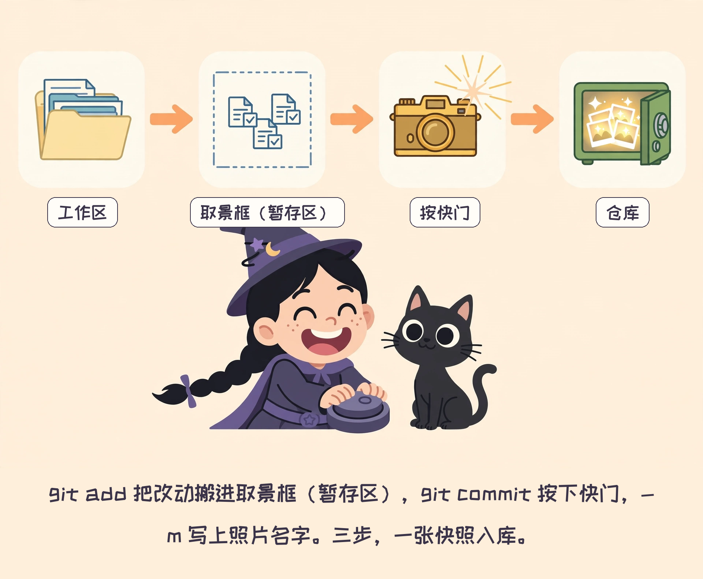
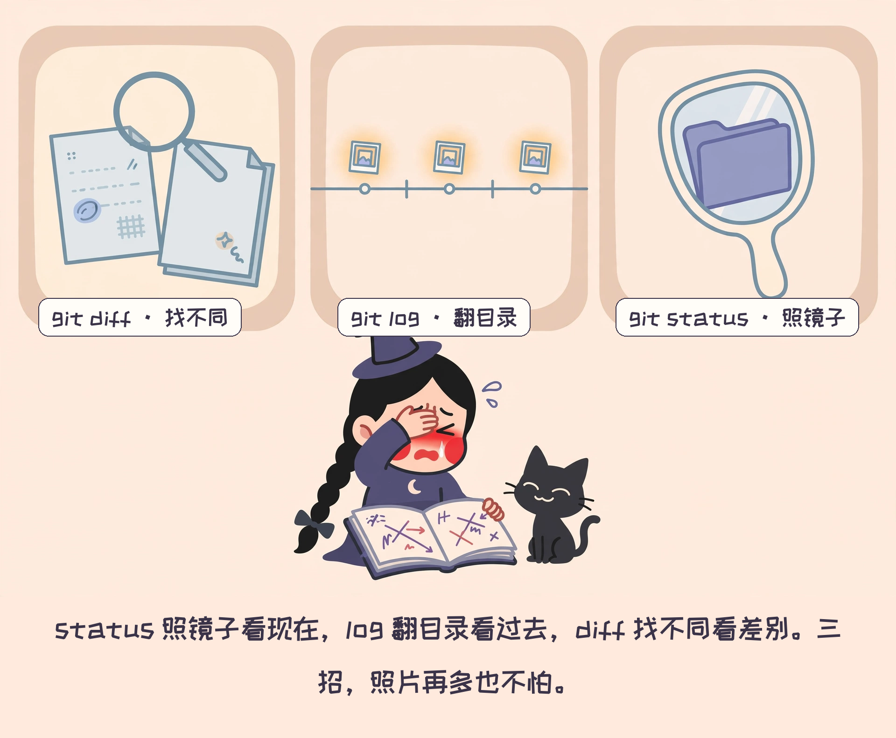
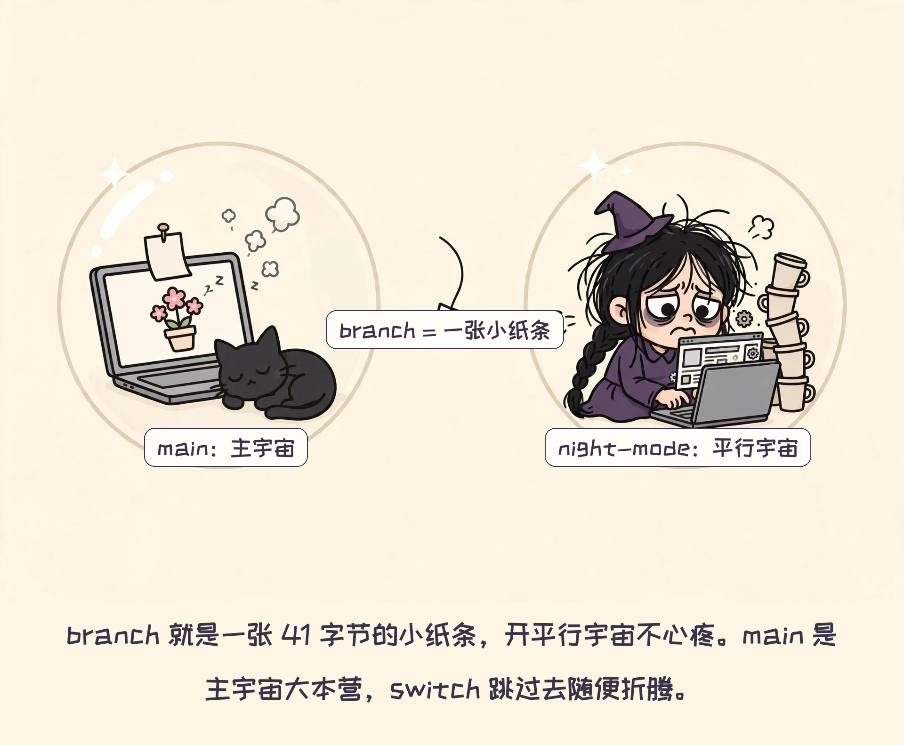
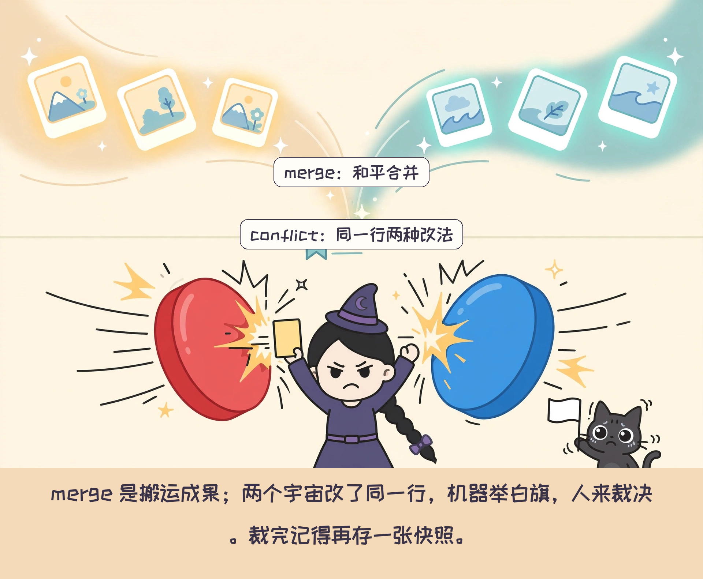
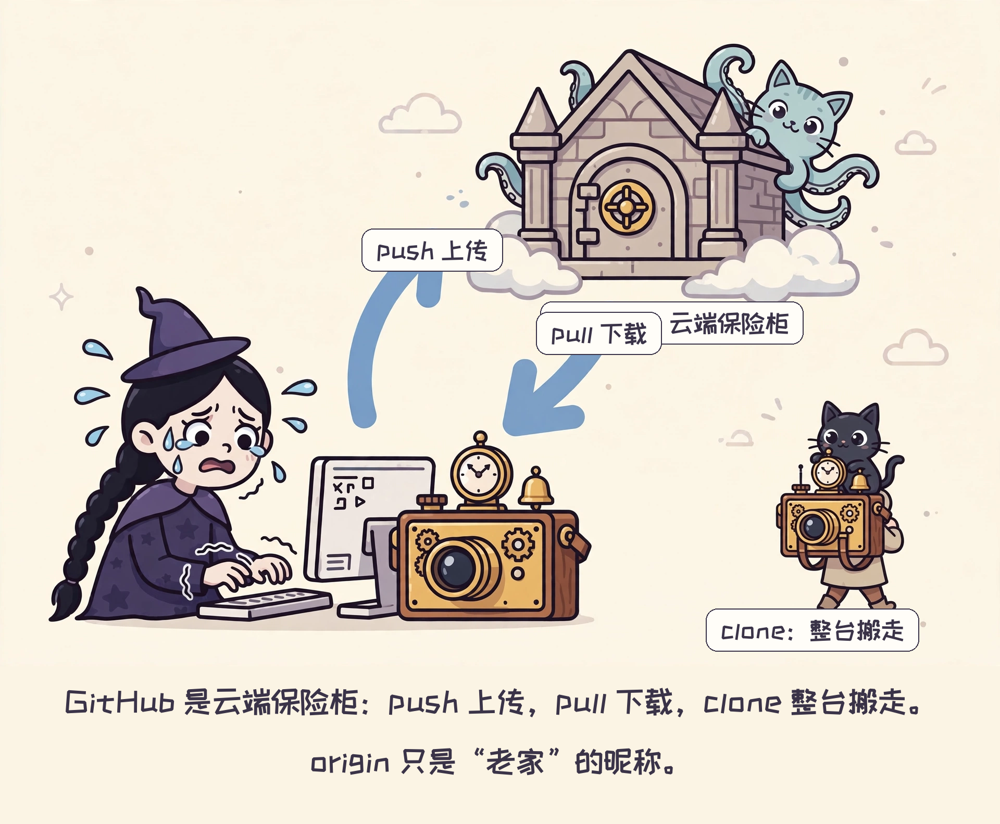
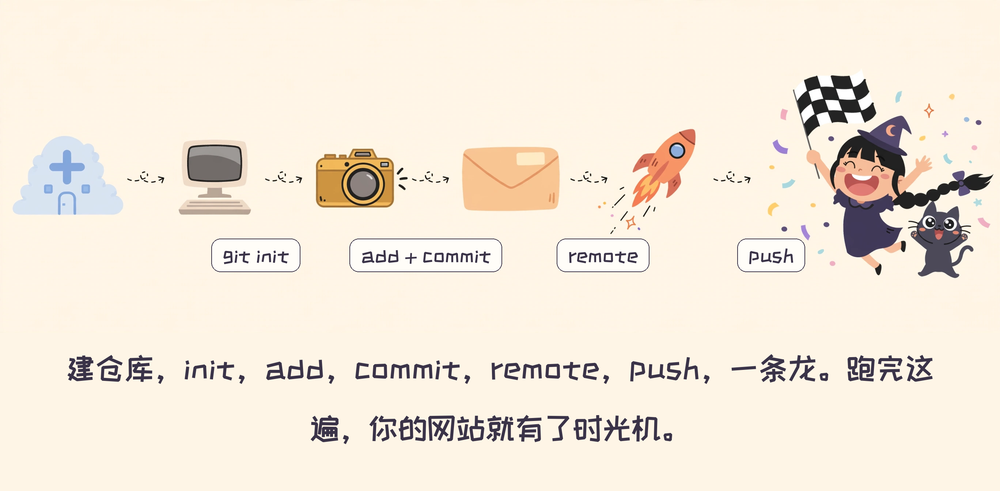
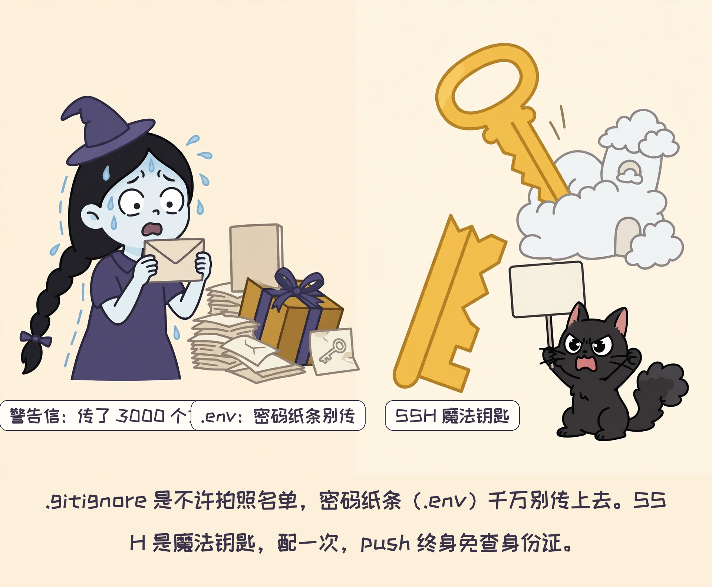
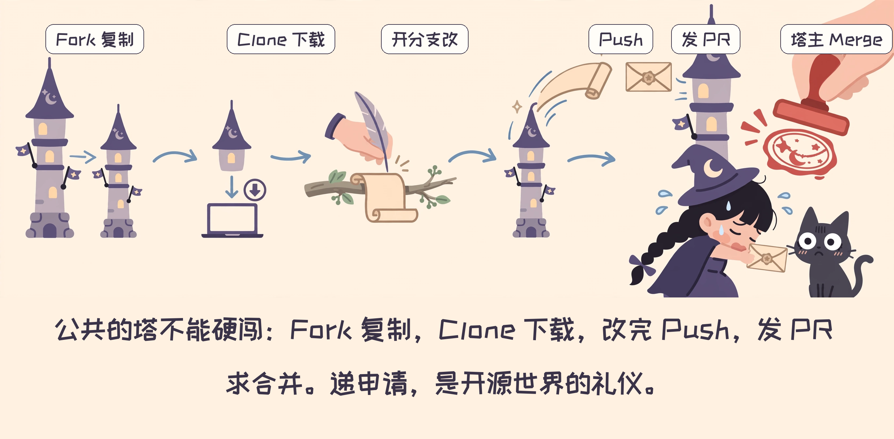
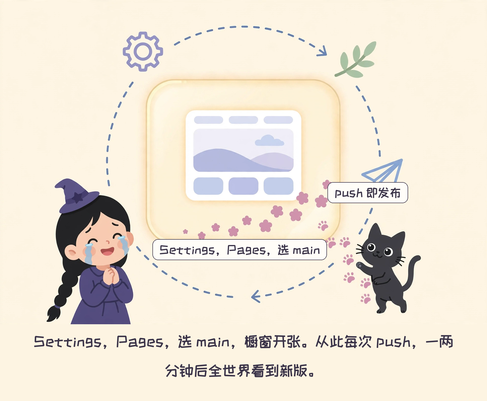

# 一千零一夜：女巫的时光机

### —— 新手 Git 上手记（第一卷：第一夜到第十一夜）

---

**开场白**

像山鲁佐德那样，说书人要用**十一个夜晚**，讲完女巫和她的时光机的故事——每晚都在天亮前，停在最要紧的地方。国王——就是你——想听下一夜，得说"再讲一夜！"。

第一夜，天黑了。女巫的第一单，开张就改崩了——

（阅读指南：每夜两条轨道。故事是主线，负责好玩；📦 教科书是平行世界，负责讲清。网页版左边故事、右边教科书。）

#---

# 第一卷 · 时光机，后悔药与平行宇宙

> Git 本地操作：版本控制 / 提交 / 撤销 / 分支 / 合并（第一夜 → 第六夜）

---

# 第一夜：为什么需要时光机


开业倒计时 11 天。

"姑娘，会做网站吗？"楼下花店的老板娘端着茶杯，站在阁楼门口，"十一天后开业，网站还没影呢。"

这是女巫出师前自己接的第一单。墙角，年糕把脸埋进第三盆猫粮，头也不抬——这猫挑食，只吃老板娘做的。女巫拿它没办法。

"接。"

第一天下午，她灵感爆棚，把首页改成了葬礼风——黑底，白字，正中一朵枯萎的玫瑰，凋零得很有艺术感。

老板娘端着茶杯路过，瞥了一眼，茶差点洒了："姑娘，我卖的是花，不是 sadness。喜庆点！"

其实店里本来就有黑玫瑰，卖得还不错——老板娘气的不是黑，是丧。首页得像花店，不能像葬礼。

女巫僵住了。她想回到今天早上——那时候首页还是粉的，花还是开的，老板娘还是笑的。

可没有时光机。她只能重做，一行一行往回改，改到半夜，边改边哭，哭到玫瑰都看不清了。

时光机，就是 Git——程序员给"后悔药"起的工程名。今晚只记住一件事：**版本控制 = 给文件拍时间快照，改崩了，翻照片回去。**

> ### 📦 教科书 · 第一夜
>
> **版本控制（version control）**：记录文件每一次变化的系统。每次记录叫一个**版本（version）**，随时可以回到任意一个版本。
> ✎ **补**：快照不占地方——Git 存的是"和上一张的差别"，不是整个文件夹复制一份。
>
> ✎ **记**：关键词两个——“记住每一次变化”“随时回去”。
>
> **为什么需要**：人会改错、会后悔、会想试新想法又怕弄坏旧的。版本控制就是"后悔药"的工程实现。
> ✎ **补**：版本控制不只给程序员——设计师管作品集，学生管论文，人人用得上。
>
> **一句话总结**：版本控制 = 给文件拍时间快照（snapshot），改崩了，翻照片回去。

**【我们的例子】** 你正在读的这篇教程，自己就是用 Git 写的：第一版用 11 个 commit 搭起，一夜一张快照。哪天我想翻出第一夜的初稿，`git log` 找到它，`checkout` 就行。版本控制不是大道理，是这篇教程的出生证明。

**【女巫的悄悄话】** 说书人敲醒木：你们知道"git"这个词，本来是什么意思吗？英式俚语里，git 是"笨蛋、讨厌鬼"。发明者 Linus 自己说的："我是个自大狂，我用自己的名字命名所有项目。先是 Linux，现在是 git。" —— 他骂的是自己。时光机的学名，是发明者的自嘲。

**【你试试】** 在电脑上建个文件夹，塞三个"网站最终版2""真的最终版"式的文件名——先体会一下没有版本控制的痛，再往下学。

**欲知后事如何**：时光机到手，第一次开机，它先问了女巫三个问题……

---

## 第二夜：开机三件事



开业倒计时 10 天。惨案之后，女巫听说有台时光机——装上它，改崩了一键回去。今晚三件事：**报上名，装机器，拍照两步走**。

第一件，报上名。

时光机开机，第一句："你谁？报上名来。"

时光机每张照片都要署名。不署名的照片，它不存。认人，是时光机家族的规矩。

第二件，装机器：

你走进网站文件夹，运行 git init——等于给它装上时光机引擎（它叫 .git，藏在文件夹里看不见）。装完，这个文件夹就升级了，从此叫仓库。

第三件，拍照两步走。女巫问："为什么不能直接拍？非要先取景？"

说书人笑了："因为你可以只拍三件衣服中的两件。取景框，在 Git 里叫暂存区（staging area）——就是让你决定，这次存什么。"

第一步，取景。把改过的文件，搬进取景框：

`.` 的意思是：全都搬，一个不留。也可以只搬一件：`git add index.html`。

第二步，按快门：

女巫第一次按快门，忘了喊名字。时光机倒没骂她，"唰"地摊开一本小册子："现想也行，写这儿吧。"

原来 `-m` 后面的，就是照片的名字。带上 `-m`，名字直接喊出来；不带，它就打开编辑器等你现写。老手都带 `-m`，快，还不用等它翻册子。

第一张快照入库。女巫长舒一口气，顺手把终端主题调成了暗黑——老板娘要喜庆，时光机里她说了算。

> ### 📦 教科书 · 第二夜
>
> **仓库（repository）**：被 Git 管理的文件夹。`git init` 会在里面建一个 `.git` 目录，从此每次变化都有记录。
>
> **工作区（working directory）**：你实际改文件的地方，就是文件夹本身。
>
> **暂存区（staging area）**：工作区和仓库之间的"取景框"。`git add` 把改动搬进去，你可以只选一部分文件，不必全存。
>
> ✎ **记**：三个区排排坐——工作区（干活）、暂存区（取景框）、仓库（相册）。add 管前一半，commit 管后一半。
> ✎ **诀**：commit 前先 `git diff --cached` 验货——取景框里装了啥，拍之前看一眼。
>
> **提交（commit）**：`git commit` 把暂存区的内容拍成一张快照，存进仓库。`-m` 后面跟本次说明（message）：带上它，名字直接喊出来；不带它，git 就打开编辑器等你现写。两种都能存，老手都带 `-m`，快。
> ✎ **记**：commit 第一行 50 字以内、祈使句（"修 bug"不写"修了 bug"）——log 里才好看。
>
>
> **标准三步**：`git add`（取景）→ `git commit -m`（快门）→ 快照入库。
>
> **一句话总结**：add 是取景（进暂存区），commit 是快门，`-m` 是照片名。三步，一张快照。

**【我们的例子】** 第二夜写完，我是这么存的：`git add git-time-machine.md` 取景，再 `git commit -m "第二夜：开机三件事"` 按快门。`git log` 里多了一行，照片洗出来了，有名字，有署名。名字起得越清楚，未来的你越感谢现在的你。

**【女巫的悄悄话】** 其实有个懒人咒：`git commit -a -m "名字"`，取景快门一步到位。但注意：`-a` 只管已经拍过照的老文件（已跟踪的），新文件还是得先 `add`，它不认生面孔。新手先练两步走，手感对了再偷懒。先学会走，再学飞。

**【你试试】** 亲手走三步：`git init` → 写个 hello.txt → `git add` → `git commit -m "你好时光机"`。再用 `git log` 找到它。

**欲知后事如何**：照片越存越多，怎么翻看？……

---

## 第三夜：翻相册



开业倒计时 9 天。照片存多了，得会翻。三招：**`status` 看现状，`log` 翻过去，`diff` 找不同**。

第一招，体检：

时光机报告："三件衣服换了，还没拍照；两张照片已存档。"哪些改了没存，一目了然。这是女巫每天念得最多的一句咒，相当于进门先照镜子。

第二招，翻目录：

相册目录，一行一张照片。哪天拍的、叫什么，全在上面。`--oneline` 是"说人话版"，不加它，日志啰嗦得像老太太的裹脚布。

女巫翻着翻着，僵住了。昨晚半夜，她把"喜庆粉"改成了"暗黑黑"，又改了回来——时光机如实记录，一点面子不给。更糟的是，log 里多了一条"年糕到此一游"：那猫半夜踩了键盘，还顺手按了快门。

第三招，找不同：

跟玩"找不同"游戏一样。改了哪几个字，哪一行多了个逗号，全给你标出来。

> ### 📦 教科书 · 第三夜
>
> **git status**：查看工作区和暂存区的状态。哪些文件被改了、哪些已取景、哪些还没拍照，一次看清。新手每天第一句咒。
> ✎ **记**：`git status` 会直接告诉你撤销命令——终端机在教你，不用死记硬背。
>
> **git log**：查看提交历史（谁、何时、拍了什么）。`--oneline` 把每条记录压成一行，目录式浏览。
> ✎ **补**：`git log -- <文件名>` 只看这一个文件的历史。
>
> **git diff**：查看"还没取景的改动"具体改了什么。工作区 vs 暂存区，逐行找不同。
>
> ✎ **记**：diff 默认比“工作区 vs 暂存区”。想看“暂存区 vs 上次提交”，加 `--cached`。
>
> **三者的分工**：status 看现在（照镜子），log 看过去（翻目录），diff 看差别（找不同）。
>
>
> **一句话总结**：status 照镜子，log 翻目录，diff 找不同。

**【我们的例子】** 不信？这篇教程自己的相册，翻给你看：

```
$ git log --pretty=format:"%s" --reverse
第一夜：为什么需要时光机
第二夜：开机三件事
第三夜：翻相册
第四夜：后悔药，兑现
第五夜：平行宇宙
第六夜：宇宙合并，与打架
第七夜：云端时间管理局
第八夜：亲手造一台
第九夜：不许拍照名单，与魔法钥匙
第十夜：请求合并
第十一夜：展示橱窗
```
一行一夜。`--reverse` 是让它从老到新排，不然最新的永远在最上面，强迫症难受。

**【女巫的悄悄话】** 时光机里有个书签，叫 HEAD，意思是"你现在站在哪张照片上"。以后你听见 `HEAD~1`，就是"往前一张照片"。先记住书签这个概念，第四夜要用。

**【你试试】** 把 hello.txt 改一个字，依次跑 `git status` / `git diff` / `git log`，说出三者的分工：状态、差别、历史。

**欲知后事如何**：翻到三天前的照片，女巫真想回去。那张照片里，网站还是好的……

---

## 第四夜：后悔药，兑现


开业倒计时 8 天。改错了怎么办？后悔药两种吃法：**创可贴只还一个文件，核按钮整条时间线倒带——但后者下手前要想清楚**。

轻量版，创可贴：

这一个文件，回到照片里的样子。其他文件，不动。精准打击。注意 `--` 后面有个空格，别念错咒，念错不灵。

重量版，核按钮，整条时间线倒带：

`HEAD~1` 就是"书签往前挪一张"。回到上一个快照。按下去之前，时光机抖三抖，弹出红字："没拍过照的改动，倒带就真没了，你想好了吗？"

女巫的手，悬在半空，抖。就在这时，年糕从桌角一跃而起，一爪子拍向红色按钮——"年糕！！！"爪子落在按钮边上，差一厘米。年糕淡定舔爪："急什么，我又不傻。"

说书人擦汗：记住，核按钮连猫都不能碰。没 commit 的改动，一次清空真没了。

> ### 📦 教科书 · 第四夜
>
> **HEAD**：一个指针（pointer，书签），永远指向"你现在站在哪"。`HEAD~1` = 上一张快照，`HEAD~2` = 上上张。
>
>
> **git checkout -- \<文件名\>**：用仓库里的版本覆盖工作区的文件。只影响这一个文件，其他不动。后悔药轻量版。
>
> ✎ **补**：新版 Git 更推荐 `git restore <文件名>`，作用一样，语义更清楚（restore = 还原）。
>
> **git reset --hard HEAD~1**：把 HEAD 指回上一个提交，同时清空暂存区、覆盖工作区。整条时间线倒带。已经 commit 过的，reflog 里还留着底，能抢救回来；但**没 commit 的改动，真没了**，神仙难救。
> ✎ **补**：push 出去的错别字别用 reset——`git revert` 新建一个"反向提交"来 undo，历史不动，最安全。
>
> ✎ **记**：`--hard` 是核按钮。没 commit 的改动，真没了——提交是你的安全带。
> ✎ **记**：`git commit --amend` 改上一次提交（忘加文件/写错字）——但 push 过的别碰。
>
> **危险等级**：checkout 是创可贴，reset --hard 是核按钮。新手先只用 checkout。
>
> **一句话总结**：checkout 修一张照片，reset 倒整条时间线。`--hard` 是核按钮，新手先别碰。

**【我们的例子】** 假如我把第三夜例子的措辞改坏了，越改越别扭——创可贴上场：`git checkout -- git-time-machine.md`，这个文件的改动回到上次 commit 的样子，其他十夜毫发无伤。至于 `reset --hard`？第一版的 11 个 commit，我一个都不想丢，核按钮一次没碰过。创可贴常用，核按钮供着。

**【女巫的悄悄话】** reset 其实有三档：`--soft`、`--mixed`、`--hard`，一档比一档狠。记住最狠的那档叫 hard 就够了，其他的等你成了大女巫再说。

**【你试试】** 故意写错一行，先用 `git checkout --` 创可贴救回来；再故意把 commit 名字写错，用 `git commit --amend` 改掉它。

**欲知后事如何**：老板娘又来了："加个夜间模式。但现在的版本别动，客人还在用。" 一个身体，怎么同时做两件事？……

---

## 第五夜：平行宇宙



开业倒计时 7 天。想试新风格又怕搞砸？**开个平行宇宙（branch），随便折腾，主宇宙毫发无伤**。

新宇宙诞生，名字叫 night-mode。主宇宙叫 main，老板娘的喜庆粉在里面睡大觉，毫发无伤。

跳过去。在新宇宙里熬夜，把配色调成"葬礼风2.0"——黑眼圈是勋章。

不加名字，就是查户口：现在有几个宇宙，前面带 `*` 的是你正站的那个。

对了，女巫还引入了一个开源花束组件"花开富贵"，展示用。就是有个小错别字，把"悬浮咒"写成了"悬浮猪"——先凑合用，开业前再说。

> ### 📦 教科书 · 第五夜
>
> **分支（branch）**：本质是一个轻量指针（小纸条），指向某张快照。开分支 = 写一张新纸条，成本极低。
>
> **git branch \<名字\>**：创建新分支（新平行宇宙）。只建不跳。
>
> **git switch \<名字\>**：切换到指定分支（跳进那个宇宙）。建完一般紧接着跳过去，也可以一步到位：`git switch -c night-mode`（新建并跳入
> ✎ **记**：`git branch 新名字` 只建不跳——你还站在 main 上，别急着 commit。）。
>
> **main**：主分支（主宇宙），默认的大本营。所有宇宙最后都要往这里汇总。
>
> **为什么分支这么便宜**：因为它只是一张 41 字节的小纸条，不复制文件。所以大胆开，别省。
> ✎ **记**：`git branch -d` 删分支，有没合并的活它不让删；大写 `-D` 才是强删。
>
>
> **一句话总结**：branch = 平行宇宙，互不干扰。main 是主宇宙，大本营。

**【我们的例子】** 假如写第五夜时，我想试试把“平行宇宙”改叫“大胆宇宙”，又怕改完后悔——开个分支：`git branch test-rename`，跳过去随便改。试完觉得还是“平行宇宙”好，分支一删，主宇宙干干净净。一张小纸条的成本，零心理负担。

**【女巫的悄悄话】** 分支在时光机里只是一张小纸条（指针），几乎不占地方，开一万个宇宙也不心疼。所以大胆开，别省 —— 这句话值得再听一遍。

**【你试试】** 开个分支 `test-rename`，跳过去随便改，改完删掉它。体会一下：一张小纸条的成本，零心理负担。

**欲知后事如何**：夜间模式调好了，怎么把成果搬回主宇宙？……

---

## 第六夜：宇宙合并，与打架



开业倒计时 6 天。分支上做完了，**`merge` 搬回主宇宙；如果两边改了同一行，时光机举白旗，人来裁决**。

先回主宇宙：

顺利的时候，无声无息，世界和平。新功能直接长在了主宇宙里。

但这次，两个宇宙改了**同一行**——night-mode 宇宙把按钮改成暗黑黑，主宇宙按老板娘的要求改成了喜庆粉。时光机举白旗："这段你自己定！我选不出来！"审美战争，终极对决。

女巫打开文件，看见了打架现场：

`=======` 上面是主宇宙的，下面是平行宇宙的。老板娘端着茶杯路过，往桌上一放："粉的。"——客户一票否决，全票通过。女巫亲手留下粉色，把暗黑版存成纪念分支，删干净标记，再存一张快照：

世界恢复和平。葬礼风2.0 躺在分支里，像没寄出的情书。

> ### 📦 教科书 · 第六夜
>
> **合并（merge）**：`git merge <分支名>`，把指定分支的成果并入当前分支。先 `switch` 回主宇宙，再 merge。
>
> **冲突（conflict）**：两个分支改了同一文件的同一行，Git 无法自动判断听谁的，合并暂停，等人裁决。
> ✎ **记**：merge 打到一半想跑？`git merge --abort` 一键回到合并前。
>
> ✎ **记**：冲突不是坏了，是 Git 在问“听谁的”。两种改法都留着，等你裁决——代码没丢，别慌。
>
> **冲突标记（conflict markers）**：`<<<<<<< HEAD` 到 `=======` 之间是当前分支的内容，`=======` 到 `>>>>>>> 分支名` 之间是对方的内容。亲手二选一（或融合），删掉所有标记符号。
>
> **裁完之后**：`git add` + `git commit` 再存一张快照，合并才算完成。
>
> **快进合并（fast-forward）**：如果主宇宙这段时间啥也没干，合并只是"把书签往前挪"，连真正的合并都算不上。
> ✎ **补**：`git log --oneline --graph` 把分支画成 ASCII 图，合并长啥样一眼看清。
>
>
> **一句话总结**：merge = 搬运成果；conflict = 同一行两种改法，机器投降，人来裁决。裁完再存一张快照。

**【我们的例子】** 标准的 merge 长这样：分支上改了个错别字，主分支上同一段也动了句话，`git merge` 时举白旗。打开文件，`<<<<<<<` 上面是主宇宙，下面是分支，亲手二选一，删干净标记，`git add` + `git commit`，世界和平。裁决权在人，不在机器。

**【女巫的悄悄话】** 快进合并时，时光机的内心独白："这点路，就不劳您费心了，我自己走过去。" —— 主宇宙没动过，它自己挪下书签就完事。

**【你试试】** 在分支和 main 里各改同一文件的同一行，合并，看冲突标记长什么样，手动裁完再 `commit`。记住 `--abort` 随时能跑。

**欲知后事如何**：女巫想把网站给另一个城市的朋友看。时光机再大，也飞不过去……

---

#---

# 第二卷 · GitHub 篇

> GitHub 远程协作：推送 / 拉取 / Fork / PR / 发布（第七夜 → 第十一夜）

---

# 第七夜：云端时间管理局



开业倒计时 5 天。本地时光机再好，老板娘看不见——**`push` 推上云端（GitHub），`pull` 拉下来，`clone` 整台搬走**。

GitHub，就是云端时间管理局。免费帮你存时间线，还能给朋友看。

先登记地址：

`origin` 只是个昵称，意思是"老家"。你叫它"月球"也行，时光机不挑。但全世界都叫 origin，你还是随大流吧。

然后，上传：

把主宇宙，推上云端。`-u` 是"记住这个地址"，下次只用喊 `git push`，它自己认路。

女巫第一次 push，管理局："token 拿来。"女巫："token 藏哪了？"她翻遍备忘录，复制出一串乱码，手抖着粘进去——错了。又粘一次，又错，冷汗下来了。第三次，终于对了。

——对，又是身份问题。GitHub 从 2021 年起就不认密码了，只认 token（个人访问令牌）。时光机家族都认人，只是现在认的是令牌。

当晚，老板娘在手机上看到了进度，盯着屏幕看了很久："这个黑的……挺别致啊。"女巫差点把茶杯打翻——审美战争，出现松动。

从云端下载别人的更新：

整台时光机复制一台，搬到新电脑：

管理局的吉祥物章鱼猫 Octocat 来串门，和年糕互相哈了三秒气，不分胜负。

> ### 📦 教科书 · 第七夜
>
> **远程仓库（remote）**：存在云端（GitHub）的仓库。`git remote add origin <地址>` 给它起个本地昵称叫 origin
> ✎ **记**：`git remote -v` 看 origin 到底指向哪——push 前看一眼，别推错家。。
>
> **推送（push）**：`git push -u origin main`，把本地 main 分支推上云端。`-u`（--set-upstream）记住对应关系，以后只用 `git push`。
>
>
> **拉取（pull）**：`git pull`，把云端的新变化下载下来并合并到本地。多人协作每天第一句咒。
> ✎ **记**：`git pull` = `git fetch`（只下载不动文件）+ merge。想先看再合，先 fetch。
>
> **克隆（clone）**：`git clone <地址>`，把云端仓库整台复制到本地，连历史照片一起搬走。换电脑、帮朋友搭环境都用它。
>
> **本地（local）vs 云端（cloud）**：本地是你的机器，云端是保险柜。push 上传，pull 下载，clone 整台搬走。
>
>
> **一句话总结**：GitHub 是云端保险柜。push 上传，pull 下载，clone 整台搬走。

**【我们的例子】** 等这篇教程推上 GitHub，流程就是第七夜这套：本地写完 `git push`，云端多一个 commit；换台电脑，`git clone`，11 夜连历史一起搬走。`origin` 这个昵称，我也随大流——全世界都叫它“老家”，我不搞特殊。

**【女巫的悄悄话】** GitHub 的吉祥物是只章鱼猫，叫 Octocat。它的身世很草根：原型是英国设计师 Simon Oxley 挂在图库网站上卖的一张 stock 插画（名字就叫“Octopuss”），被 GitHub 创始人买下来做了 404 页面。为什么偏偏是章鱼？因为 git 里有个“octopus merge”（章鱼合并，一次合好几个分支）——章鱼猫就是这个梗的化身。“八只手同时干活”是后人附会的说法，可爱，但别当官方口径。

**【你试试】** 跑 `git remote -v`，看 origin 到底指向哪；再 `pull` 一次，体会"先下载（fetch）再合并"。

**欲知后事如何**：故事听了七夜。第八夜，不讲故事了，动手……

---

## 第八夜：亲手造一台



开业倒计时 4 天。今晚毕业考：**从零走完 `init`→`push` 全流程，你的网站就有时光机了**。今夜没有女巫，只有你。

1. 去 GitHub 建一个仓库，叫 joyce-way，公开。
2. 本地咒语：`git init` → `git branch -M main`（给主宇宙上户口：有些 Git 默认分支不叫 main，先改名） → `git add .` → `git commit -m "我的第一张快照"` → `git remote add origin <你的仓库地址>` → `git push -u origin main`

（自我介绍那两行，前面已经念过了，这里不数。）

从此，你的网站有了时光机。改崩不怕，平行宇宙随便开。你大概还会装上依赖大礼包 node_modules——几千个文件，先别放在心上，第九夜它会惹祸。

说书人收起醒木："八夜讲完。考试通过——女巫从见习女巫，变成了时间领主。"

国王（你）："再讲一夜！"

说书人："别急。考试是考试，开业是开业。剩下三天，真刀真枪——且看时间领主的第一场实战。"

**【我们的例子】** 第八夜那条龙，这篇教程的本地部分就是这么游过来的：`git init` 建仓库 → `git add` 取景 → `git commit` 快门，一夜一游，游了 11 次。剩下的 `remote` + `push`，等发布那天，照着第八夜再游一次就行。

国王（你）："再讲一夜！"

说书人："欲知后事如何，且看你的第一行 `git init`。"

**【你试试】** 从空文件夹开始，五步走完：init → add → commit → remote → push。走完你就亲手发布过一回了。

**欲知后事如何**：网站传上云端了。但三天后，女巫收到管理局的警告信……第九夜，GitHub 篇。

---

**真问题**：你的第一台时光机，准备先存什么？

---

# GitHub 篇（第九夜 — 第十一夜）

---

## 第九夜：不许拍照名单，与魔法钥匙



开业倒计时 3 天。有些东西不许拍照：密码纸条，垃圾文件。**`.gitignore` 是不许拍照名单；总输 token 烦？配把 SSH 魔法钥匙，一劳永逸**。

女巫第二次 push，兴高采烈。第二天，管理局寄来警告信：

"你上传了 3000 个文件。其中 2990 个是垃圾。另：你把密码纸条也传上来了，全世界都能看见。"

（第八夜你装的那个大礼包？同一封信，已经在路上了。）

女巫后背发凉——毕业考那天装的依赖大礼包 `node_modules`，几千个文件，全传上去了！还有 Mac 的小尾巴 `.DS_Store`，和一张写着密码的小纸条 `.env`！

说书人摆摆手："别慌。时光机有个'不许拍照名单'，叫 `.gitignore`。名单上的东西，以后 `git add .` 都搬不走——注意，是"以后"。已经入库的，名单管不着。"

女巫在仓库根目录建了个小本本，写下三行：

年糕凑过来："把我的毛也加上！我的毛不许拍！"女巫："你的毛已经满世界都是了，来不及了。"——上次核按钮没拍中，这次它要留名，没门。

已经传上去的那 3000 个，得办出库手续：`git rm -r --cached node_modules`（出库不删文件，只把它们请出时间线，剩下两个同理）。再 commit 一次，云端就清静了。

"还有那张密码纸条，"说书人脸色一正，"已经公开的，名单拦不住——密码，立刻换。这是铁律。"

搞定名单，新的烦恼来了：每次 push，管理局都要查身份证（输 token）。女巫想起那三遍冷汗："再也不想输第四次。"说书人说："两条路。HTTPS 让系统的钥匙串记住 token，以后免查——这是管理局官方推荐的正道；或者配一把 SSH 魔法钥匙，一劳永逸。"

女巫选了钥匙——她喜欢仪式感。

一把钥匙掰成两半：私藏的那半（私钥）谁也不给，交公的那半（公钥）贴到 GitHub 的 Settings → SSH keys。从此 push，碰一下就行。

临睡前，女巫想把暗黑设计稿塞进名单藏起来，被说书人戳穿："名单是防垃圾的，不是藏私货的。"

> ### 📦 教科书 · 第九夜
>
> **.gitignore**：放在仓库根目录的"不许拍照名单"。每行写一个规则：`node_modules/`（整个文件夹）、`.DS_Store`（单个文件）、`*.log`（通配符 wildcard，所有 log）、`!.keep`（`!` 是例外，这个要拍）。
>
> **必备三件套**（网站项目）：`node_modules/`、`.DS_Store`、`.env`。`.env` 里是密码密钥，传上公开仓库等于把家门钥匙贴在布告栏。
>
> **注意**：名单只对"还没拍过照的"生效。已经 commit 进去的，得先删掉再加名单。
>
> ✎ **记**：`.gitignore` 只管“还没拍照的”。已经 commit 的，先 `git rm --cached <文件名>` 取消跟踪（本地文件还在），再进名单
> ✎ **补**：`.DS_Store` 这种每台机器都有的垃圾，配一次全局忽略，不用每个仓库写一遍。
> ✎ **补**：别手写 ignore 规则——github.com/github/gitignore 有官方模板，抄。。
>
> **SSH**：`ssh-keygen -t ed25519 -C "邮箱"` 生成钥匙对。公钥（`.pub` 结尾）贴到 GitHub，私钥自己藏好，谁也不给。
>
> **HTTPS vs SSH**：HTTPS 是 GitHub 官方推荐的方式，配合系统凭据管理器（比如 macOS 的钥匙串）记住 token 后，之后 push 不用每次都输；SSH 则是配一次钥匙、之后免打扰。两种都行，看你顺手。故事里走 SSH，是因为“配一次管终身”听起来很爽。
>
> ✎ **补**：GitHub 官方推荐 HTTPS + 凭据管理器记 token。新手先走 HTTPS，SSH 是进阶玩具。
>
> **一句话总结**：.gitignore 是不许拍照名单，SSH 是魔法钥匙。一个管干净，一个管省事。

**【我们的例子】** 这篇教程的仓库根目录下，躺着一个 `.gitignore`。里面写着：半成品图（带 -labeled、-diagram 后缀的）不许入库，只有成品图（night-*-wide-v1.png）才配进仓库。名单在前，仓库才干净。发布那天，HTTPS 和 SSH 二选一：钥匙串记住 token，或者配一把 SSH 钥匙——手册推荐前者。

**【女巫的悄悄话】** 真实事故类型：有人把云服务密钥传上公开 GitHub，被扫号机器人抓到盗刷，账单爆炸——这类事故在圈内隔段时间就来一出。现在 GitHub 有 secret scanning，抓到密钥会自动报警，但别指望它，先写好名单。

**【小挑战】** 给你的网站项目写一个 `.gitignore`，三行起。写完 `git status` 看一眼，垃圾还在不在。

**【你试试】** 写个 `.gitignore`，把 `.DS_Store` 和 `*.log` 写进去，再 `git status` 验证垃圾消失。

**欲知后事如何**：钥匙配好，管理局的门为她敞开。但她发现，管理局里还有别的女巫在修同一座塔……

---

## 第十夜：请求合并



开业倒计时 2 天。别人的仓库不能硬闯：**Fork 复制到你名下，改完发 PR（Pull Request，请求合并），等人家点头**。

还记得"花开富贵"组件上那个"悬浮猪"吗？开业前，女巫决定把它修好。她挽起袖子想直接改，push 被拒："这不是你的宇宙！"（Permission denied）

说书人笑了："公共的塔，不能硬闯。正确的姿势叫 PR。五步走："

1. **Fork**：在云端复制一座塔到你名下（点一下按钮就行）。
2. **Clone**：把你的塔下载到本地。
3. **开分支改**：`git switch -c fix-typo`，把"猪"改回"咒"。
4. **Push**：推回你自己的塔。
5. **发 PR**：点 "Compare & pull request"，写句话："把猪改回咒，猪很无辜，但咒更重要。"

塔主（仓库主人）看到了，提了个小意见："顺手把隔壁的'飘浮猪'也改了吧。"女巫改完再 push，PR 自动更新，不用重发。

塔主点了 Merge，还顺手把组件的默认主题改成了"暗夜"——原来开源世界，有人懂她。错别字消失。女巫的名字，出现在了贡献者名单里。

> ### 📦 教科书 · 第十夜
>
> **复刻（Fork）**：在 GitHub 云端把别人的仓库复制一份到你名下。和 clone 的区别：fork 是云端复制，clone 是下载到本地。
>
> ✎ **记**：fork 是云端复制（到你名下），clone 是下载到本地。先 fork 再 clone，顺序别反
> ✎ **补**：PR 可以发 draft 草稿——"还没写完，别 review"，降低心理门槛。
> ✎ **记**：改个错别字不用开终端——GitHub 网页点铅笔图标，改完直接 commit。。
>
> **PR（Pull Request，请求合并）**：向原仓库主人发出的合并申请。"我改好了，求 review，求合并。"
>
> **标准五步**：Fork → Clone → 开分支改 → Push 到自己的仓库 → 发 PR。
>
>
> **Code Review（代码审查）**：塔主 review 你的改动，提意见，你改完再 push，PR 自动更新。合并前把关，保证质量。
>
> **Merge**：塔主点合并，你的改动正式进入主宇宙。你的名字留在贡献者名单里。
>
> **PR 是开源（open source）世界的通用语言**：不会 push 别人的仓库，就用 PR。这是程序员社交的基本礼仪。
>
> **一句话总结**：Fork 复制，改完 push，发 PR 求合并。公共的塔不硬闯，递申请。

**【我们的例子】** 这篇教程暂时还没开过 PR——它还在我手里长大。但流程已经想好了：发布之后，谁发现错别字，欢迎 Fork → 改 → 发 PR。“把猪改回咒”这种好事，在这篇教程里同样有效。开源的礼仪，从第一卷就开始。

**【女巫的悄悄话】** GitHub 有个"种田游戏"： contribution graph（贡献小绿格）。每天 commit 格子就绿一块，有人为了填满一年的绿格天天打卡 —— 程序员式的自律，可爱又心酸。

**【小挑战】** 去 GitHub 找一个你喜欢的开源项目，只看它的 PR 列表，读三个 PR 的标题和描述，感受"请求合并"的语气。

**【你试试】** 去 GitHub 网页上找个文件的铅笔图标，改个错别字直接 commit——体会"不用终端也能贡献"。

**欲知后事如何**：PR 被合入了！名字上了贡献者名单。但她自己的网站，还躺在本地睡觉，没人看得见……

---

## 第十一夜（终夜）：展示橱窗



开业当天。网站躺在仓库里只有自己能看——**GitHub Pages 是免费展示橱窗，`push` 即发布**。

管理局有个"展示橱窗"，叫 **GitHub Pages**。把网站放进橱窗，免费，全世界可看。

步骤简单得像开灯：

1. 打开仓库的 **Settings** → 左侧 **Pages**。
2. Source 选 **Deploy from a branch**，分支选 **main**。
3. 保存。等几分钟。

网址诞生：`https://witch.github.io/joyce-way/`

年糕第一个访问，在网站上踩出了一串梅花印 —— 第一个访客，是只猫。

从此，每次 `git push`，橱窗自动更新。改完 push，一两分钟后，全世界看到新版。不用 FTP，不用服务器，不花一分钱。

开业那天，花店第一单：隔壁咖啡店订了开业花篮。老板娘开香槟，茶终于没洒。她举杯："黑色系卖完了——暗黑系列，下次安排！"女巫的眼泪差点掉进香槟里：她输了现在，赢了未来。

老板娘端出一小碟猫饭，放到年糕面前。挑食的猫闻了闻，吃了——开业第一天，它赏脸了。

说书人合上书："十一天，十一夜。女巫的时光机，讲完了。"

国王（你）："再讲一夜！"

说书人笑："下一卷，是你的故事了。"

> ### 📦 教科书 · 第十一夜
>
> **GitHub Pages**：GitHub 免费的静态网站托管。把仓库变成网站，一个网址，全世界访问。
>
> **开启三步**：Settings → Pages → 选 main 分支 → 保存。等一两分钟，网址生效。
>
> ✎ **记**：Settings → Pages → main → 保存。等一两分钟，不是下一秒——去喝口水
> ✎ **记**：Pages 只接待静态网站（HTML/CSS/JS）——后端代码放上去跑不起来。
> ✎ **补**：建个和用户名同名的仓库，README 会显示在 GitHub 主页——免费名片。。
>
> **用户站（user site）vs 项目站（project site）**：`用户名.github.io` 是你的门面（一个账号一个）；`用户名.github.io/仓库名` 是每个项目的橱窗。先开项目站，够用。
>
> **自动重新部署**：每次 push 到 main 分支，Pages 自动重新发布。改完就推，推完一两分钟上线。
>
>
> **自定义域名（custom domain）**（以后）：可以把自己的域名（如 joyce 的双域名）绑上去，现在先用免费网址跑通。
>
> **免费额度**：公开仓库免费。私人小站，完全够用。
>
> **一句话总结**：Settings → Pages → 选 main → 全世界可见。push 即发布。

**【我们的例子】** 第十一夜写完，这篇教程离“橱窗”只差三步：Settings → Pages → 选 main。发布那天 push 一下，一两分钟后全世界看到新版。到时候，第一个访客希望不是年糕——它只会踩梅花印，不会提 PR。

**【女巫的悄悄话】** 你的 curtainraiser 学习站，就可以这样发布。无数开源项目的文档，都住在 Pages 的橱窗里 —— 免费、稳定、体面。

---

说书人收起醒木："十一夜讲完。第一卷，Git + GitHub 篇，完。"

"女巫从见习女巫，变成了时间领主，开了家云端橱窗，还往公共的塔里添了一道咒。"

国王（你）："再讲一夜！"

说书人："第二卷，山鲁佐德正在写。欲知后事如何——"

**【你试试】** 给你的仓库开 Pages，把生成的网址发给朋友。你的第一个展品，上橱窗了。

**真问题**：你的橱窗里，第一个展品是什么？

---

# 术语表

十一夜所有关键词，一页查完

- **版本控制（version control）** — 记录文件每一次变化，随时回去。
- **仓库（repository）** — 被 Git 管理的文件夹。
- **工作区（working directory）** — 你实际改文件的地方。
- **暂存区（staging area）** — 取景框，决定这次存什么。
- **提交（commit）** — 按快门，一张快照进仓库。
- **git status** — 照镜子，看状态。
- **git log** — 翻目录，看历史。
- **git diff** — 找不同，看差别。
- **HEAD** — 书签：你现在站在哪张照片上。
- **git checkout -- <文件名>** — 创可贴，还原一个文件。
- **git reset --hard** — 核按钮，倒带整条时间线。
- **git revert** — 反向提交，安全撤销已 push 的。
- **git commit --amend** — 改上一次提交（忘加文件/写错字）。
- **分支（branch）** — 平行宇宙，一张小纸条（指针），几乎不占地方。
- **git branch <名字>** — 只建不跳，你还站在原地。
- **git switch <名字>** — 跳进那个宇宙。
- **main** — 主宇宙，大本营。
- **合并（merge）** — 把宇宙合回主宇宙。
- **冲突（conflict）** — 同一文件的同一行两边都改了，等人裁决。
- **快进合并（fast-forward）** — 主宇宙没动过，书签往前挪。
- **git merge --abort** — 合并打一半，一键回到合并前。
- **远程仓库（remote）** — 云端的仓库。
- **推送（push）** — 传上云。
- **拉取（pull）** — fetch（只下载）+ merge。
- **克隆（clone）** — 整仓下载到本地。
- **.gitignore** — 不许拍照名单。
- **SSH / HTTPS** — 两把云端钥匙。
- **复刻（Fork）** — 云端复制到你名下。
- **PR（Pull Request）** — 请求合并，开源世界的通用语言。
- **GitHub Pages** — 免费静态网站橱窗，push 即发布。
